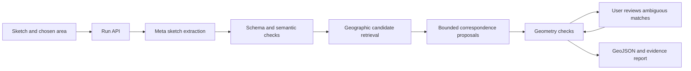

# Proposed architecture

## Stack and boundaries

Use a modular application: **React + TypeScript + Vite** frontend, **FastAPI + Pydantic** Python backend, **MapLibre** map display, **NumPy/SciPy + pyproj** for geometry. Optional Shapely handles exported geometry validity. Lock tested dependencies during scaffolding; no unverified latest-version promises.

Primary documentation: [Vite](https://vite.dev/guide/), [FastAPI](https://fastapi.tiangolo.com/), [Pydantic](https://docs.pydantic.dev/latest/), [MapLibre](https://maplibre.org/maplibre-gl-js/docs/), [SciPy fitting](https://docs.scipy.org/doc/scipy/reference/generated/scipy.optimize.least_squares.html), [pyproj](https://pyproj4.github.io/pyproj/stable/).

## Model roles

- Proposed primary model: `muse-spark-1.3` via the server-side Meta adapter. Interpret image features; propose candidate IDs and targeted clarification questions. Current docs describe [image input](https://dev.meta.ai/docs/image-understanding) and [JSON Schema output](https://dev.meta.ai/docs/structured-output). Correct shape does not establish correct meaning. Actual performance on our inputs is **UNVERIFIED**.
- Keep prompts, schemas and a few labeled examples versioned beside the feature. The model sees input and allowed candidates; evaluator ground truth remains separate.
- No SAM dependency in the initial map-photo flow: a justified segmentation experiment can be added later. Optional speech uses [the transcription adapter](https://dev.meta.ai/docs/speech-to-text) only after its own gate. No extra model is included just to increase model count.

## Data contracts

| Contract | Essential fields and rules |
|---|---|
| SketchGraph | image dimensions, landmarks `{id,label,type,x,y}`, relations and evidence; x/y normalized in [0,1], unique IDs, relation endpoints must exist |
| Candidate | stable source ID, label/type, longitude/latitude, retrieved timestamp, attribution; must be within the chosen area |
| MatchProposal | sketch ID, candidate ID or null, evidence and competing candidates; server looks up coordinates |
| Confirmation | prior run revision, accepted/corrected correspondence, actor=user; optimistic concurrency prevents stale edits |
| AlignmentResult | transform family, accepted anchors, inliers, residuals, independent-check errors if available, unresolved items |
| Export | GeoJSON in longitude/latitude order, feature status, original sketch ID, source provenance; no invented exact roads |

Coordinate flow: normalized sketch coordinates → image plane with explicit y-axis convention → local projected metres for fitting → longitude/latitude for export. Select an appropriate local CRS; never measure metres directly in geographic degrees. Start with robust similarity alignment (rotation, uniform scale, translation), minimum three distinct non-collinear accepted anchors for this product, and outlier rejection. Detect reflection/orientation problems. Introduce affine fitting only if evaluation shows a need. Avoid flexible warps that hide bad correspondences.

## Geography access

Geocoding locates the selected area; candidate retrieval uses a bounded, cached OSM extract through an adapter. Keep the source/licence manifest with each evaluation snapshot. Geographic coverage must be checked before claiming support. Map tiles and geodata are different services.

If using the public Nominatim service, aggregate requests server-side, cache and identify the app, honor its 1 request/second maximum, and do not implement client autocomplete against it. Use a configurable provider. [Nominatim policy](https://operations.osmfoundation.org/policies/nominatim/). Display attribution and follow the selected tile provider's terms; the OSM public tile server has no availability guarantee. [OSM licence](https://www.openstreetmap.org/copyright), [tile policy](https://operations.osmfoundation.org/policies/tiles/).

## Execution and persistence

`POST /api/runs` returns a run ID; `GET /api/runs/{id}` polls status; `PATCH /api/runs/{id}/confirmations` resumes review; `GET /api/runs/{id}/export` returns confirmed results. A versioned OpenAPI contract generates frontend types.

State machine: created → extracting → retrieving → matching → needs_confirmation/validating → ready, with failed/cancelled/interrupted terminal paths. Cap model calls, retries, input size and elapsed work. Retry transient failures at most twice with backoff; semantic ambiguity asks the user rather than silently retrying indefinitely.

Hackathon deployment: one service serving compiled frontend and API, one bounded worker, SQLite run/events store and a persistent artifact directory. Persist stage results before advancing. On restart, mark in-progress runs interrupted and offer explicit retry; do not pretend in-process tasks survive a crash. Run the service with one process initially. A managed queue/object store is a later scale decision, not a first-week dependency.

Keep API keys server-side. Use random run capability tokens with server-side access checks, MIME/size validation, a controlled deletion action and an upload retention limit. Treat drawing text and transcripts as input data. They cannot change tool permissions, invoke arbitrary URLs or execute commands. Record model ID, prompt/schema version, timings, token usage when returned, candidate snapshot hash and user edits. Never log secrets.

## Tests that matter

Unit: coordinate conventions, outlier handling, degenerate anchors, nonexistent candidate IDs. Integration: adapter timeout, interrupted/resumed job, correction invalidating stale alignment. Evaluation: blind sketch set, manual/simple-transform baseline, unknown/ambiguous areas. End-to-end: upload → correction → export with correct provenance. Mock responses test plumbing only and remain visibly marked.
